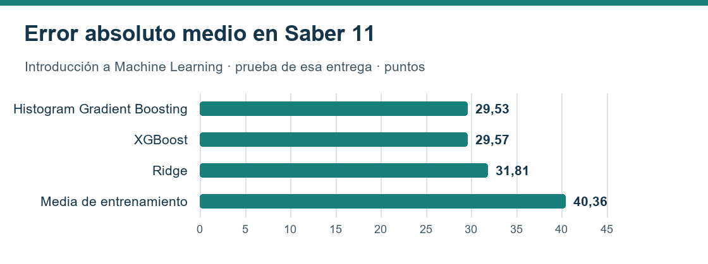

# Saber 11 | Analítica educativa

Tres entregas de la Universidad Nacional de Colombia alrededor de la misma pregunta: ¿cuánto del puntaje global de Saber 11 se puede estimar a partir del contexto socioeconómico, familiar e institucional?

## Entregas finales

| Materia | Código y metodología |
| --- | --- |
| [Machine Learning](entregas/machine_learning_final.ipynb) | Particiones, codificación de municipios, modelos de regresión y errores por subgrupos. |
| [Big Data](entregas/big_data_final.ipynb) | Ingesta por clave de partición, Cassandra, Dask, Parquet y evaluación. |
| [Deep Learning](entregas/deep_learning_final.ipynb) | MLP, red residual, Transformer tabular, transferencia y evaluación pareada por institución. |

[Abrir el resumen reproducible con los datos agregados incluidos](analisis.ipynb).

## Qué aportó cada materia

| Materia | Trabajo y resultado documentado |
| --- | --- |
| **Introducción a Machine Learning** | Comparé con el equipo una referencia constante, Ridge y modelos de árboles. En la prueba de esa entrega, Histogram Gradient Boosting obtuvo MAE de **29,53 puntos** frente a **40,36** para la referencia de la media. |
| **Big Data** | La entrega implementó una ingesta con **Apache Cassandra** y una lectura particionada con **Dask**. Se procesaron **7.109.704 filas** de entrada y quedaron **5.720.733 claves únicas** en Cassandra. |
| **Deep Learning** | El equipo comparó redes para datos tabulares y estrategias de transferencia. El MLP seleccionado obtuvo **29,88 puntos de MAE** frente a **40,26** para la mediana, en su conjunto de prueba. El ajuste fino no mejoró en promedio sobre entrenar solo con los datos de destino bajo el protocolo de esa entrega. |



Los errores de ML y Deep Learning se interpretan frente a su propia referencia. Sus protocolos y criterios de selección se documentaron por separado. Los modelos se diseñaron para investigación exploratoria y el error agregado no justifica decisiones individuales sobre estudiantes.

## Datos y reproducción

El extracto estudiado tiene **51 columnas** y **23 códigos originales de periodo** entre 2010 y 2022. El [cuaderno](analisis.ipynb) reproduce la lectura de los [conteos y métricas agregados](datos/) a partir de las entregas guardadas. La tabla de volúmenes conserva códigos originales como `20194` y `20224`. El paquete no ejecuta la infraestructura distribuida ni vuelve a entrenar los modelos.

Puedes recalcular los conteos del CSV con el script siguiente. Es útil para verificar el corte disponible antes de cotejarlo con la entrega de 2026.

```bash
python contar_periodos.py ruta/al/archivo.csv --salida volumen_actual.csv
```

[Resultados únicos Saber 11 · Datos Abiertos Colombia](https://www.datos.gov.co/es/Educaci-n/Resultados-nicos-Saber-11/kgxf-xxbe/data_preview) · [Bases y diccionarios · Icfes](https://www.icfes.gov.co/transparencia-y-acceso-a-la-informacion-publica/datos-abiertos/acceso-a-bases-de-datos-y-diccionarios/)

**Equipo académico** Manuela Zapata Jiménez y David Cardona Duque.

**English summary.** Three course projects on Colombian educational assessment, covering regression baselines, Cassandra and Dask ingestion, and tabular neural-network experiments. The portfolio includes aggregate results and a reproducible cohort-volume check.

